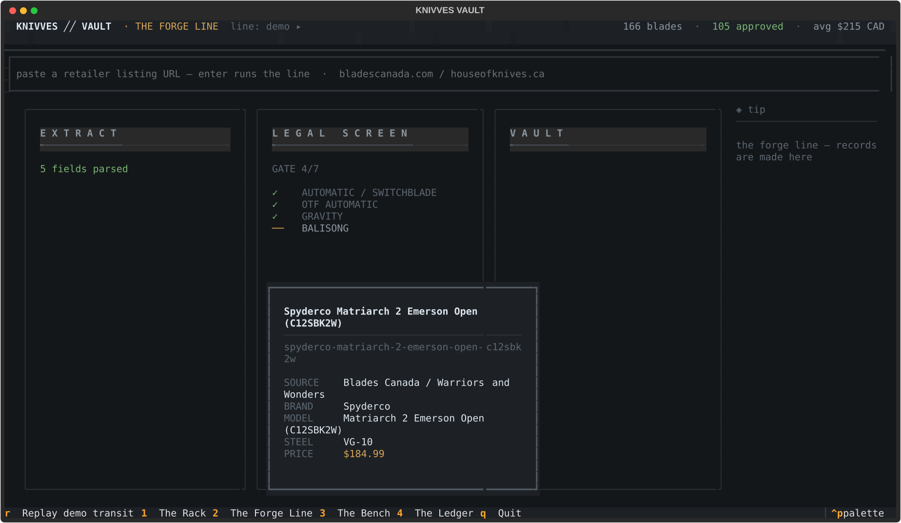
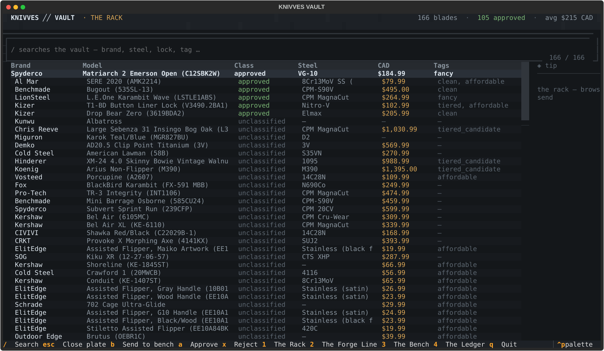
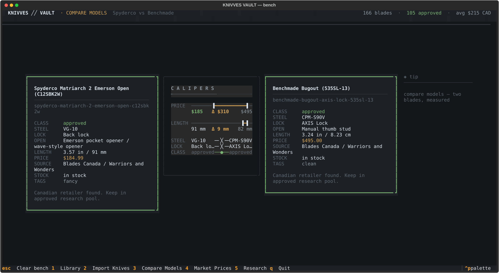
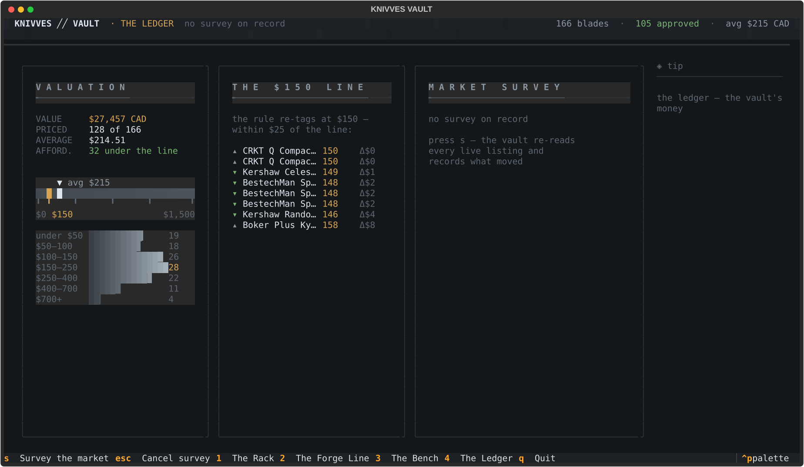

# KNIVVES ╱╱ VAULT

**A personal knife-research database built as a place you enter, not an app you open.**

`knivves` is a local-first terminal application for folding-knife research in
Canada — built with [Textual](https://github.com/Textualize/textual), designed
as one coherent machine: rooms behind a vault door, records as physical
objects, your own acquisition rules executing visibly on screen.



## The building

Everything lives in one building with four rooms. You arrive through a
machined vault door — drawn steel leaves, a bolt cascade, staged parting —
and every record is a **plate**: one physical object with one visual
identity that travels between rooms.

### The Rack — browse



The collection. Click a column header to sort (again reverses — the active
sort reads on the masthead). `/` is a live filter across everything a
record knows. Click a knife and its plate travels in while the rack
recedes behind it. Judge from the chair: `a` approves, `x` rejects — the
row recolors, the database writes, the counts tick.

### The Forge Line — intake

The room the app is named for. Paste a retailer listing URL and watch the
vault do its own research: a blank plate appears at EXTRACT and the
listing's actually-parsed fields stamp on as they arrive; the plate
travels to LEGAL SCREEN where the database's own prohibited-mechanism
rulebook executes gate by gate — a hit slams the gate and stamps the
plate REJECTED; a cleared plate travels on and files into the real
database, already in the rack when you return. `r` replays a
deterministic no-network demo of the transit.

### The Bench — compare



Send any knife from the rack with `b` — its plate follows you here.
Between two plates, the calipers **take the measurement**: readings appear
line by line — price delta with the cheaper blade marked, blade length
delta in millimetres, spec match/differ — and hold. Gaps read
"incomparable — missing measurement": honest gaps, never guesses.

### The Ledger — price intelligence



The vault's money on drawn instruments: the average price rides a
machined scale with the $150 affordable rule cut into it in accent; the
price distribution is gradient-lit bars. Press `s` and the vault
**surveys its own market** — every live listing re-read, price history
appended to every record, movers surfacing by magnitude, and the
affordable rule re-tagging whatever crossed the line. Cancel anytime;
observations made are kept.

## Why it looks the way it does

The design is governed by house laws that are code, not convention
([knivves/vault/laws.py](knivves/vault/laws.py)):

1. **One palette.** Machined darks, steel text, classification colors,
   a single amber accent. No room introduces a color.
2. **One field grammar.** Every labeled value everywhere renders through
   the same function — the plate, the gates, the masthead, the bench.
3. **One motion law.** Objects travel; they never teleport and never
   fade. Every animation shares one easing.

The surfaces are drawn, not styled: the vault door's leaves, the
masthead's brushed grain, the engraved station headers, and the Ledger's
instruments are all custom `render_line` widgets that own every cell
they paint.

## Quickstart

```bash
# from this folder
uv sync          # or: python -m pip install -e .
knivves vault
```

Keys, everywhere: `1`–`4` rooms · `ctrl+p` command palette · `t` expands
the tip rail's ❯ mark into a capsule · `esc` closes/clears · `q` quits.
The mouse works on everything the keyboard does.

Your live database is a plain JSON file at `~/.knivves/knives.json`
(first run copies the bundled starter). Point elsewhere with
`KNIVVES_DB=...`. Writes are atomic; backups land in `~/.knivves/backups/`.

## The classic CLI

The original Rich CLI ships alongside the vault and works on the same
database:

```bash
knivves                          # classic interactive table
knivves list -q bugout           # search
knivves list -section affordable # filter by SectionID (-t/--tag is the alias)
knivves list -new                # only knives currently tagged NEW
knivves list --min-price 200 --max-price 600 --sort price
knivves list --output csv > knives.csv
knivves show <id>                # one record
knivves approve <id>             # classification from the shell
knivves add ledger.md            # ingest a markdown link ledger (see below)
knivves update                   # advance the NEW generation line
knivves new -threeg              # keep NEW across three updates
knivves buylist                  # The Reserve: acquisition priorities + Σ CAD
knivves add / section / note / retailer …
knivves backup / restore / import / export / doctor
```

## The ingestion ledger — `knivves add <file.md>`

Knives arrive in batches, as links. The ledger is a markdown file built
for dense lists with clear separation:

```markdown
-------------------------------
# KNIFE ADDITIONS

-------------------------------
// BuyList

-------------------------------

> descending priority — the top entry is the next acquisition

- [Brand Model, Steel, Handle, SKU](https://retailer.ca/product)
// Canadian Tire *NewSource*, *AffordableSource*
- [Another Knife - SKU](https://retailer.ca/other)

-------------------------------
```

The grammar, exactly:

- **SLI** (Section Line Indicator): a line of exactly **31 dashes**. SLIs
  separate areas and make long lists ingestible.
- The file title is the only `#` heading; every other heading is a
  `// SectionID` line — SLI directly above it, an empty line after it,
  then a closing SLI.
- `*Tag*` markers on a SectionID attach that tag to the whole section; a
  `//` line *inside* a section body annotates the entries after it with
  a source name and tags.
- A section named **BuyList** (any spelling that contains buy + list) is
  the acquisition priority ladder — its order is the priority. Sections
  containing **source** register retailer sources instead of knives.

The parser is tolerant: swapped `[url](label)` links, URLs split across
lines, `[label]<url()>` angle forms, `(REF)`/`#REF` reference numbers,
tracking queries, and `TODO:` placeholders are all repaired and reported
(`--dry-run` shows the full plan without writing).

## NEW and the three-generation cache

Every ingested or added knife is stamped into the open *generation* and
reads **★NEW** everywhere — tables, the interactive browser, the Rack,
the masthead. `knivves update` is the line that decides what counts as
NEW: it seals the current batch as the newest NEW generation. A knife
stays NEW from the moment it's filed, *through* the update that seals
it — with the default `-oneg` cache it ages out on the second update,
and `-twog`/`-threeg` stretch survival to two or three updates.
`knivves new` lists what's fresh; `knivves new --status` shows the cache
state; `knivves update --survey` also re-reads every supported live
listing concurrently — a progress bar carries count/elapsed/ETA, movers
print as they land, every observation is appended to `price_history`,
and the $150 affordable rule re-tags line-crossers, exactly like the
Ledger room's survey.

## Data model

A top-level `knives` array of records:

```json
{
  "id": "brand-model-key-variant",
  "brand": "Brand",
  "model": "Model (SKU)",
  "user_classification": "approved",
  "user_tags": ["clean"],
  "research_status": "canadian_retailer_verified",
  "acquisition_status": "approved_for_further_research",
  "mechanism": {
    "opening_method": "Manual thumb stud",
    "lock_type": "Frame lock",
    "assist_type": "manual",
    "blade_length": "3.5 in",
    "blade_steel": "M390",
    "clear_prohibited_mechanism_found": false
  },
  "canadian_online_retailers": [
    {
      "retailer": "Canadian retailer name",
      "url": "https://example.ca/knife",
      "listed_price_cad": 300.0,
      "availability": "in stock",
      "source_date": "YYYY-MM-DD"
    }
  ],
  "price_history": [{ "date": "YYYY-MM-DD", "price_cad": 300.0 }],
  "notes": "Freeform notes"
}
```

The `affordable` tag is the only auto-assigned tag: any knife whose best
price sits under $150 CAD carries it; surveys re-apply the rule.

**SectionID** is the application's formal word for these group
identifiers (`user_tags` remains the storage field; `tag` remains a
command alias). Freshness state lives beside the records: each knife
carries `added_generation` / `date_added` / `new`, the top-level
`updates` block tracks the generation line and its history, `buy_list`
holds the ordered acquisition ladder (materialized as `buy_priority` on
members), and `sources` registers retailer sources from ingested
ledgers.

## Development notes

- **Tested by driving, not by mocking the UI**: a headless
  [Pilot suite](tests/test_vault_shell.py) boots the app against a
  throwaway database copy and drives real clicks, keys, and hovers
  through every capability — including layout laws (the traveling plate
  can never clip off-screen; the tip rail must sit beside the data's
  last column; the depth nudge must return).
- **Eyes-on verification**: during development every visual change was
  captured headlessly (`App.export_screenshot`), rendered, and examined
  before judgment — the frames in `docs/media/` are produced by that
  pipeline, not by hand.
- Scope honesty: single-user local app; live intake currently supports
  bladescanada.com and houseofknives.ca; unsupported URLs fault cleanly
  at EXTRACT.
